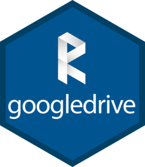

---
format:
  gfm:
    default-image-extension: ""
---

<!-- README.md is generated from README.qmd. Please edit that file -->


```{r}
#| label: setup
#| include: false
auth_success <- tryCatch(
  googledrive:::drive_auth_docs(),
  googledrive_auth_internal_error = function(e) e
)

knitr::opts_chunk$set(
  collapse = TRUE,
  comment = "#>",
  error = TRUE,
  purl = googledrive::drive_has_token(),
  eval = googledrive::drive_has_token()
)
```

```{r}
#| eval: !expr '!googledrive::drive_has_token()'
#| echo: false
#| comment: ""
googledrive:::drive_bullets(c(
  "Code chunks will not be evaluated, because:",
  strsplit(auth_success$message, split = "\n")[[1]]
))
googledrive::drive_deauth()
```

# googledrive <a href="https://googledrive.tidyverse.org"></a>

<!-- badges: start -->
[](https://CRAN.R-project.org/package=googledrive)
[](https://github.com/tidyverse/googledrive/actions/workflows/R-CMD-check.yaml)
[](https://app.codecov.io/gh/tidyverse/googledrive)
<!-- badges: end -->

## Overview

googledrive allows you to interact with files on Google Drive from R.

## Installation

Install the CRAN version:

```{r}
#| eval: false
install.packages("googledrive")
```

Or install the development version from GitHub:

```{r}
#| eval: false
# install.packages("pak")
pak::pak("tidyverse/googledrive")
```

## Usage

Here's a teaser that uses googledrive to view some of the files you see on <https://drive.google.com> (up to `n_max = 25`, in this case):

```{r}
library("googledrive")
drive_find(n_max = 25)
```

## Where to learn more

[Get started](https://googledrive.tidyverse.org/articles/googledrive.html) is a more extensive general introduction to googledrive.

Browse the [articles index](https://googledrive.tidyverse.org/articles/index.html) to find articles that cover various topics in more depth.

See the [function index](https://googledrive.tidyverse.org/reference/index.html) for an organized, exhaustive listing.

## Contributing

If you'd like to contribute to the development of googledrive, please read [these guidelines](https://googledrive.tidyverse.org/CONTRIBUTING.html).

Please note that the googledrive project is released with a [Contributor Code of Conduct](https://googledrive.tidyverse.org/CODE_OF_CONDUCT.html). By contributing to this project, you agree to abide by its terms.

## Privacy

[Privacy policy](https://www.tidyverse.org/google_privacy_policy)
